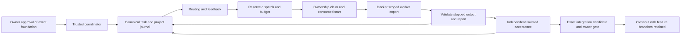

# Destination workflow architecture proposal

Status: proposed, awaiting owner approval. This package prepares an offline
implementation foundation; it grants no execution authority. The existing
runtime remains unaccepted. No controller, startup router, CI gate, paid worker,
provider access, credential delivery, Git publication or merge is activated.

Destination: `ai-template-oop`, retained branch `feature/workflow-migration`,
base `a3dafc636054a85eeed6eaeb4c10e1fcb9d020a4`. Source reference:
`universal-ai-project-template@d6e582b7edeae24345a175f36639230726dbdead`.
The destination `CLAUDE.md`, `PROMPTS.md` and `BRANCH_RETENTION.md` govern this
adaptation. Donor autonomy, ACTIVE approval and automatic closeout authority
do not transfer. Imported packet files remain byte-equivalent Git blobs.

## Components and authority

Keep a coordinator-operated control plane in `scripts/` and workflow config
in `config/`. These are host administration tools, separate from application
ABCs and `src/`. This milestone does not add a workflow UI or change application
contracts. Future application I/O changes require architect approval and linked
UI work against the same interface revision; no headless exemption is created.

| Component | Named owner role | Input and output | Destination adaptation |
| --- | --- | --- | --- |
| Bootstrap gate | Owner approves; coordinator prepares | Bound architecture and policies -> approval receipt | Use the destination validator and review package; never copy donor ACTIVE state. |
| Routing | Routing/feedback maintainer | Packet, role, history, immutable rates and availability -> decision and reasons | Preserve risk/complexity/tier floors and expected cost per accepted result. Synthetic resources remain disabled. |
| Feedback | Routing/feedback maintainer | Reservation, report, review rejection, diagnosis -> replayable task state | Preserve IDs, pending dispatch, failure fingerprints, cumulative caps and explicit holds. |
| Dispatch and ingestion | Execution maintainer | READY packet and verified dependencies -> brief, run binding, result | Coordinator renders a bounded export; reports are untrusted, validated and never self-accept. |
| Runtime and ownership | Isolation maintainer | Approved scope and reserved dispatch -> isolated run, stopped output | Retain `workflow_scope.py` and `workflow_runtime.py`; repair consumed-start authority before use. |
| Acceptance | Independent acceptance owner | Exact candidate, deterministic evidence, bounded reviewer report -> decision | Keep implementer/acceptor separation, reviewer floors and exact artifact binding; checks run in a separate isolated export. |
| Shared state and handoff | Coordinator/record keeper | Ledger heads, decisions, blockers, candidate references -> startup view | One canonical host-local journal shared across this repository's worktrees; views are derived, never authority. |
| Integration and closeout | Integrator under explicit owner authority | Accepted candidate, exact branch tips and required checks -> integration record | Replace donor cleanup with permanent branch retention. No auto-merge authority is inherited. |

Roles identify responsibility, not currently provisioned identities. Later
task INIT and reviewer reservations must name actual actors; a placeholder or
the implementer acting as acceptor is refused. No agents are delegated by
preparing or approving this package.

## Docker boundary remains mandatory

Retain the inspected image identity
`sha256:61526e68966dc3330c3801cbed8740c62710376b0b01b15c960b60c66b6cae1e`
and the existing digest-pinned Dockerfile. A rebuild has a new identity and
requires fresh evidence. Top-level Cline/jsonschema/pytest versions are pinned;
transitive package resolutions remain unlocked. The measured image, rather
than a mutable tag or a claim of reproducibility, identifies the tested runtime.

Workers remain UID/GID 1000 with network `none`, read-only root, capabilities
dropped, no-new-privileges, private process namespace, bounded memory/CPU/PIDs,
tmpfs, file size and rotated logs. A fresh Docker volume supplies only enumerated
packet/scope/baseline/files; immutable directories and inputs remain root-owned.
No host bind mount, Git objects/history, Docker socket, ownership token/database,
task ledger, credentials, sibling implementation or connector is supplied.
Shell tools execute within the same boundary. The fixed offline initializer is
the only root preparation step. A worktree remains a Git destination, not a
read-access barrier. Current file-count/size and direct-write constraints remain.

Acceptance commands declared by an architect are also untrusted execution:
run them in a fresh bounded Docker export, never directly with coordinator
credentials or journal access. An integration export may contain the named
combined candidate, but still cannot access the host control plane. Docker
Desktop, host coordinator, image and kernel remain trusted. Multi-account and
multi-machine coordination is outside this approval scope.

Provider egress and credential delivery remain disabled. A later proposal must
name provider-only endpoints, credential custody, usage collection, prices and
negative access tests; unrestricted networking is not an implementation option
under this package.

## Separate durable stores

Resolve the repository identity from the Git common directory, as the existing
`state_directory()` does. Independent state overrides remain refused. On Windows
the host-only root is under `LOCALAPPDATA/ai-template-workflow/<identity>`.
Do not instantiate a database or create this directory for package validation.

| Store | Authority | Contents |
| --- | --- | --- |
| `ownership.sqlite3` | Runtime ownership only | Unique branch/workspace claims, owner/run/scope/container, lease, durable consumed-start flag, stopped/preserved evidence. No task lifecycle or cost accounting. |
| `control.sqlite3` (planned) | Task, review and project history | Append-only canonical event payloads, sequence/previous hash, UTC timestamp, task/role/revision/dispatch, configuration/rates/approval anchor, review decisions, budget holds, project decisions and integration references. |
| `run-*/` evidence | Evidence addressed by digest | Exact exports, briefs, output archives, validated replacement bundles, reports, redacted usage and logs. No secret values. |
| Shared startup/handoff views | Derived summaries | Objective, owned paths, branch/base/diff, interface revision, pending dispatch, costs/caps, ledger heads, blockers and next action. Regenerate from authority; reject stale views. |

Use SQLite transactions with full synchronous durability for the new journal;
an event insert compares the expected stream head and reserves its sequence
atomically. Preserve donor event JSON, hashes and replay semantics inside this
storage adapter; do not change canonical packet hashing. Export numbered JSON
as an audit view, not a second writable journal. Validate a full existing source
chain before a one-time import, retain its IDs/bytes/head, and record an import
receipt. Never synthesize a new INIT that resets attempts or spend. There is no
existing destination task ledger to convert today.

This deliberately adapts donor `feedback.append()`/`acceptance.append()`:
their exclusive JSON file creation detects writer collisions, but directory
fsync is POSIX-only and a crash can leave a partial final file. The Windows
journal must pass process-kill/restart and concurrent append tests on the actual
filesystem. Broken/gapped chains and missing evidence cause a hold, not repair
by deleting history. Backups retain journals and referenced evidence together;
restore verifies heads/digests before scheduling. No automatic evidence purge
or branch cleanup is included.

## Reservation, launch and restart sequence

Cross-database operations use a durable, idempotent state machine, rather than
claiming an atomic transaction across ownership, task journal and Docker:

1. Preflight validates approval anchor, READY packet, VERIFIED dependencies,
   current base/interface/scope, role, disabled/live policy, resource binding,
   prompt size, deadline and remaining attempts/budget. Refusal spends nothing.
2. Under a journal transaction, reserve one dispatch and its cost ceiling. A
   unique pending dispatch per task/role prevents duplicate reservations.
   Persist packet/config/rates/anchor and planned scope hash before rendering.
3. Render immutable brief/rules and export; acquire the ownership claim; record
   the dispatch-to-run link. A post-reservation preparation failure consumes the
   reserved attempt and is explicitly abandoned; it is not a free retry.
4. Commit a durable launch-consumed record **before** any Docker start side
   effect. Associate it with the dispatch and ownership token. Commit remains
   consumed even if start, log capture or preservation fails. Repeat and racing
   execution with the same authority are refused. Do not put this update in a
   transaction whose rollback after a Docker error revives authority.
5. Start only after both stores agree on the run/dispatch, consumed authority
   and live claim. Timeout is the minimum of runtime bound and reservation's
   absolute deadline. Stop/inspect the entire container tree, capture bounded
   logs and preserve output before releasing ownership. A cleanup failure keeps
   the claim; expiry does not permit takeover or restart.
6. Validate a report and exact replacement bundle, then record RESULT once.
   Duplicate identical ingestion returns the existing result; conflicting or
   stale ingestion is refused. Finish the claim only with preservation evidence.
7. On coordinator restart, reconcile the journal, ownership and Docker facts.
   A reserved dispatch with no claim cannot launch implicitly; explicitly
   abandon or complete preparation under the recorded reservation. A consumed
   start with no trustworthy outcome is never restarted. Confirm stop and
   preserve output, record unknown metered cost where charging was possible,
   then resolve/abandon before another attempt. Orphaned claims/evidence cause a
   hold. Recovery and start serialize; an old token cannot be revived.

The existing startup-token retry defect is a release blocker. This proposal
documents the repair; it does not apply it or claim it has passed regression.

## Routing, feedback and bounded budgets

Retain source `route()`/`record()` verification, contract worker/reviewer tier
floors, risk and complexity floors, provider availability and consecutive,
non-descending escalation history. Choose the cheapest eligible resource by
expected cost per accepted result using declared acceptance probability,
latency, review/regression costs and labeled observations. Priors are estimates,
not measured success. Context headroom counts actual rendered brief/rules,
harness overhead and reserved output. No enabled resource means no dispatch.

The proposed worker default is two attempts; the packet may lower it. Tier caps
are `min(task cap, packet tier cap, policy tier cap)`, with policy tiers
0..4 capped at 3/3/2/2/1. Reviewer attempts are capped at two overall for the
task, including rejection/resubmission; use the minimum of routing, acceptance
and packet limits. This resolves source examples with router limit 2 versus
acceptance limit 3. PR automated review rounds have a separate ceiling of four;
they do not replenish task or reviewer attempts.

Preserve repeated failure thresholds (two per tier, three total), one contract
repair, three blocker resumptions, five architect diagnoses, 600-second attempt
deadline and bounded recent history. Normalize failure fingerprints while
retaining original evidence. A repeated acceptance rejection becomes a bounded
corrective failure; it does not grant a new task or reset counters. Architecture
conflict, scope expansion, exhausted caps, changed approval and unknown costs
hold execution for the appropriate owner decision. Resumption or contract repair
requires unchanged approved foundation and preserves lifetime counts/spend.

Live API budgets in this package are **USD 0** for task, role and project.
No paid model authorization is proposed. Offline fixtures simulate costs.
Before any later metered use, bind real rates/date/provider/model and explicit
per-task/role/project caps, and reserve against all caps atomically. Include
reviewer and integration model use in project spend. Settled costs plus pending
ceilings must fit every applicable cap. Unknown liability remains held and
blocks more metered dispatch until evidence-backed reconciliation.

Usage supplied through a worker is an untrusted claim. Capture harness/provider
usage into coordinator evidence, bind it to the dispatch and saved rates, and
prefer that measurement. Preserve source conservative cache accounting and
rounding up. A metered zero without measured usage is unknown; an abandoned
possibly charged run is unknown; an explicitly unmetered run may cost zero.
For the destination, an unmeasured positive worker estimate also remains
unverified liability, rather than a settled spend amount. A hard cap requires
an enforceable token/output ceiling and trustworthy provider usage; if these
are unavailable, metered launch stays disabled.

## Report ingestion and independent acceptance

Adapt `execution_harness.dispatch()`/`report_valid()`/`ingest()` and
`worker_launcher.prepared_run()` to the Docker adapter. Do not import the donor
host subprocess launch path: environment filtering alone is not isolation.
Bind dispatch/task/role, packet and contract hash, base/interface/scope, image,
brief/rules/config digest, output bundle digest, UTC deadline and ledger heads
in a coordinator envelope without changing the canonical packet schema.

Bound sizes, reject links/junctions/escaped paths and duplicate/unknown validation
IDs, require every declared check, scan credential-like content before errors
can echo it, and reject invalid types and contradictory PASS claims. Host code
checks immutable inputs and exact allowed replacement paths at the recorded
base; validation does not apply, accept or promote output. An explicit later
apply operation needs the owned branch, unchanged base and prior scope check.
Missing-context requests name exact paths/symbols and reasons; coordinator
supplies the smallest new approved scope revision or a separate proposal.

Worker PASS advances only to acceptance pending. A named independent actor
reruns architect-declared deterministic checks against a digest-bound candidate
in a new isolated runtime and evaluates every acceptance criterion. Preserve
source gate floors: low = deterministic; medium adds model review; high adds
cross-family review; critical adds architect review and user decision. Packet
requirements may strengthen them. No floor-reducing waiver is proposed.
Same-actor acceptance is refused; high/critical review must also satisfy family
and reviewer-tier floors. Unavailable hardware stays unverified and blocks
required hardware gates; simulations never substitute for real evidence.

Acceptance binds task/revision/contract plus artifact reference **and** content
digest, exact feature/UI/base commit identities, interface revision, scope and
validation image/environment. A changed submission invalidates all earlier gate
evidence while retaining the review history and consumed budget. Sync to feedback
is idempotent and verifies the same binding; an unrelated ledger cannot confer
VERIFIED status. Implementation, testing, independent acceptance, integration
and deployment are separate recorded facts.

## Branch-preserving closeout and delivery

Adapt donor readiness assessment only. Do not import its `clean_up()` or execute
`closeout.py merge`: the pinned implementation deletes local and origin branches.
Keep destination feature branches permanently, with their names and full history.
Never force-push, reset, replace them with archive aliases, or use branch deletion
as cleanup. Retain worktrees/evidence pending a separate retention decision.

Future readiness checks require the exact reviewed head, successful destination
contract/boundary and affected runtime checks, independent acceptance, resolved
actionable findings, review-round cap and verified live required-check behavior.
Inspect hosting `delete_branch_on_merge=false` immediately before any authorized
merge; cached historical evidence is insufficient. If true, hold for the owner
to change it. This package performs no GitHub request or settings change.

Use deliberate merge commits under later owner authority. Record feature/UI/base
heads and resulting main merge SHA; a queued PR is not a completed merge.
Preserve feature tips and synchronize main into the retained branch deliberately
before its next packet. Verify two successive releases from the same branch
without duplicate changes, history loss or local/origin branch disappearance.
Closeout updates only coordinator shared records and preserves dirty work.

## Minimal pinned dependencies and implementation order

The package's `source_dependencies` records exact Git blob IDs and LF-normalized
SHA256 hashes. The eight existing packet/provenance files remain intact.
The additional runtime closure is router, feedback, execution harness, launcher,
acceptance, bootstrap validation, CLI colors/progress, and the four controller
schemas. `cli_exit`, packet/domain schema/helpers and jsonschema==4.26.0 are
already present. No new Python library is needed for approval validation or the
proposed journal beyond stdlib SQLite; existing jsonschema serves controllers.

Donor bootstrap gate/schema, bounded worker/reviewer rules and closeout are
design references to adapt, not executable imports. Donor tests for the five
controllers, bootstrap and closeout are behavioral references to port, then add
destination Windows/Docker and crash-recovery cases. Donor project validator,
broad governance documents, skills, connector setup, ACTIVE config, provider
examples/fictional prices, legal profiles and hardware sample app are excluded.
Create small destination coordinator records; do not copy source project history.

After explicit approval, implement in dependency order: (M1) consumed-start
repair and offline retry/race tests; (M2) canonical control journal/bootstrap
adapter and interruption tests; (M3) router/feedback/budget controllers;
(M4) Docker dispatch/report adapter; (M5) independent acceptance adapter;
(M6) shared resume views and retained-branch closeout readiness. Each milestone
has the package's named acceptance criteria. Full rollout, model access,
application contract changes, publication and merge still need later authority.
Do not mark any milestone accepted from this architecture document.
